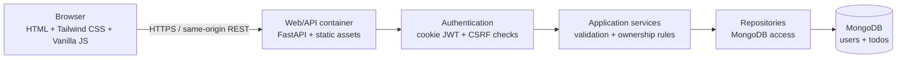
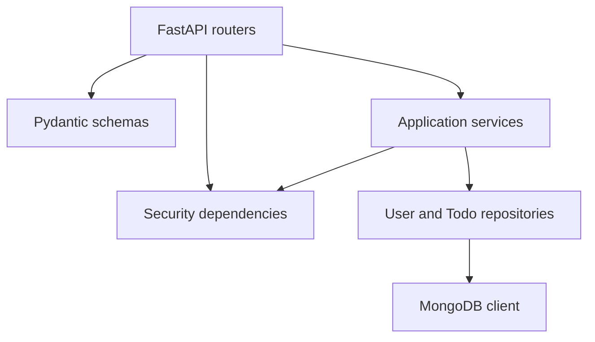
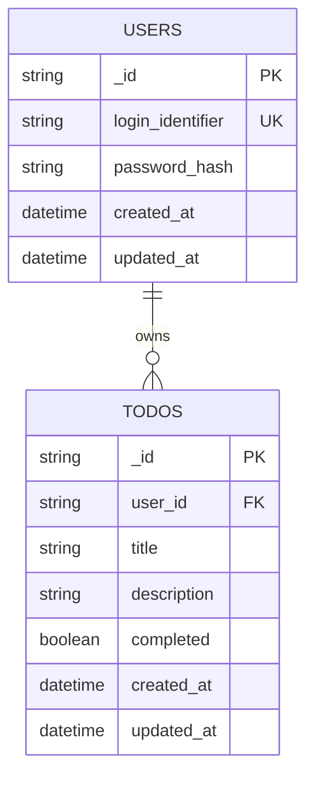
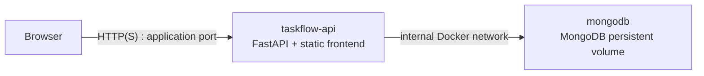
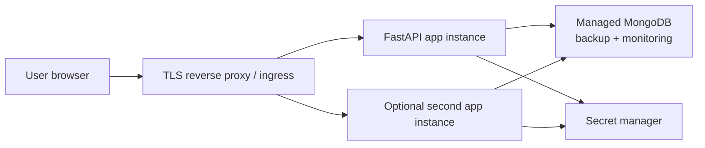

# TaskFlow System Architecture

**Status:** Architecture baseline  
**Inputs:** Approved TaskFlow Project Brief and Product Requirements Document  
**Scope:** MVP  
**Architecture style:** Small layered monolith with a separately served static frontend and MongoDB

## 1. High-Level Architecture

TaskFlow uses a browser client, a FastAPI application, and MongoDB. The browser serves the HTML/CSS/Vanilla JavaScript UI and calls the REST API using same-origin requests. FastAPI owns authentication, validation, authorization, business rules, and persistence access. MongoDB stores users and todos.

The application is intentionally kept as one backend service for maintainability. Internal layers provide separation without introducing microservice complexity.

### Architectural principles

- Keep the deployment small: one FastAPI container and one MongoDB service for local/MVP use.
- Keep HTTP concerns, business rules, and persistence concerns separate.
- Derive user identity only from a validated authentication token.
- Apply `user_id` ownership filters to every todo read and mutation.
- Use explicit validation and safe error responses at the API boundary.
- Use environment configuration for secrets and service addresses.

## 2. Frontend Architecture

The frontend is a lightweight single-page-style interface built with HTML, Tailwind CSS, and Vanilla JavaScript. It does not own authorization decisions; it requests protected resources and responds to API status codes.

### UI areas

- **Auth views:** signup and signin forms.
- **App shell:** authenticated navigation, logout control, and route/view switching.
- **Dashboard view:** total, completed, and incomplete counts.
- **Todo view:** create form, list, edit interaction, delete action, and complete/uncomplete control.
- **Feedback layer:** field validation, loading states, empty states, success notices, and safe errors.

### Frontend modules

- `api client`: centralized `fetch` wrapper, JSON handling, credentials policy, and CSRF header handling.
- `auth state`: current unauthenticated/authenticated UI state; no sensitive token value is exposed to JavaScript.
- `views`: render dashboard, todo list, auth forms, and empty/error states.
- `todo actions`: create, update, delete, and status transitions.
- `validation`: client-side usability checks; server validation remains authoritative.

The server should serve the static frontend from the same origin in the MVP. This simplifies cookie scope, CORS, and deployment. If the frontend is later hosted separately, the API must use an explicit allowlist rather than wildcard origins.

## 3. Backend Architecture

FastAPI is organized into layers:

1. **API/router layer:** route definitions, request/response schemas, dependency wiring, status codes.
2. **Security layer:** password hashing, JWT creation/verification, cookie extraction, CSRF and origin checks.
3. **Application/service layer:** signup/signin workflows, todo operations, dashboard aggregation, ownership rules.
4. **Schema/validation layer:** Pydantic request and response models, field constraints, normalization.
5. **Repository layer:** MongoDB queries and updates; repository methods require the authenticated `user_id` for todo operations.
6. **Infrastructure layer:** MongoDB client lifecycle, configuration loading, logging, and health checks.

No router should construct unrestricted todo queries. Repository methods for todo access should require both the todo ID where applicable and the authenticated user ID.

## 4. MongoDB Collections

### `users`

Representative document shape:

| Field | Type | Purpose |
|---|---|---|
| `_id` | string UUID | Stable user identifier |
| `email` or chosen login identifier | string | Unique normalized login identifier |
| `password_hash` | string | Argon2id or bcrypt hash; never returned |
| `created_at` | UTC datetime | Account creation time |
| `updated_at` | UTC datetime | Account update time |

The API response model must exclude `password_hash`.

### `todos`

Representative document shape:

| Field | Type | Purpose |
|---|---|---|
| `_id` | string UUID | Stable todo identifier |
| `user_id` | string UUID | Owning user; references `users._id` logically |
| `title` | string | Required task text |
| `description` | string or null | Optional task details if enabled |
| `completed` | boolean | Completion state |
| `created_at` | UTC datetime | Creation time |
| `updated_at` | UTC datetime | Last update time |

MongoDB stores UUIDs as strings by design for consistent API serialization and simple debugging. MongoDB does not enforce a foreign key; application ownership rules enforce the logical relationship.

## 5. Database Relationships and Indexes

Relationship:

Required indexes:

- `users.login_identifier`: unique index for duplicate-account prevention.
- `todos.user_id, todos.created_at`: compound index for a user's task list ordered by creation time.
- `todos.user_id, todos.completed`: compound index for dashboard counts and status filtering.
- Optional `todos.user_id, todos.updated_at` if the chosen list ordering uses update time.

All indexes should be created as part of application initialization or an explicit deployment migration step and verified in startup checks.

## 6. REST API Endpoint Design

All responses use JSON except static frontend assets. Protected requests use the HttpOnly auth cookie and a CSRF header for state-changing methods.

| Method | Path | Auth | Purpose |
|---|---|---|---|
| `POST` | `/api/auth/signup` | Public | Create a user account |
| `POST` | `/api/auth/signin` | Public | Verify credentials and set auth/CSRF cookies |
| `POST` | `/api/auth/logout` | Authenticated + CSRF | Clear authentication cookies |
| `GET` | `/api/auth/me` | Authenticated | Return safe current-user identity |
| `GET` | `/api/todos` | Authenticated | List only current user's todos |
| `POST` | `/api/todos` | Authenticated + CSRF | Create a todo owned by current user |
| `GET` | `/api/todos/{todo_id}` | Authenticated | Read an owned todo |
| `PATCH` | `/api/todos/{todo_id}` | Authenticated + CSRF | Update allowed todo fields |
| `DELETE` | `/api/todos/{todo_id}` | Authenticated + CSRF | Delete an owned todo |
| `POST` | `/api/todos/{todo_id}/complete` | Authenticated + CSRF | Mark an owned todo complete |
| `POST` | `/api/todos/{todo_id}/uncomplete` | Authenticated + CSRF | Mark an owned todo incomplete |
| `GET` | `/api/dashboard/stats` | Authenticated | Return current user's counts |
| `GET` | `/health` | Service/public | Liveness/readiness status without sensitive data |

### API conventions

- Use `201 Created` for successful account and todo creation.
- Use `200 OK` for successful reads and updates; use `204 No Content` where a response body is unnecessary.
- Use `400` for malformed requests, `401` for missing/invalid authentication, `403` for failed CSRF/origin protection, `404` for inaccessible or missing resources without disclosing ownership, and `409` for duplicate identifiers.
- Use a stable error shape such as `{ "error": { "code": "...", "message": "...", "fields": [...] } }`.
- Serialize UUIDs as strings and datetimes in a consistent UTC format.
- Do not accept `user_id` in todo create/update payloads.

## 7. Authentication Architecture

Authentication is cookie-based:

1. User submits credentials to `/api/auth/signin`.
2. FastAPI verifies the password hash.
3. FastAPI issues a short-lived signed JWT containing a subject (`sub`) set to the user UUID, an issued-at time, an expiration time, and a token type/version.
4. The JWT is set in an `HttpOnly`, `Secure` cookie with an appropriate `SameSite` policy.
5. A separate readable CSRF cookie contains a random CSRF value; JavaScript copies it into an `X-CSRF-Token` header for state-changing requests.
6. The authentication dependency validates the JWT and loads the current user identity.
7. Logout clears the auth and CSRF cookies.

The browser never reads the JWT. `fetch` uses `credentials: "same-origin"` for same-origin API calls.

For the small MVP, the JWT may be stateless with a short expiration. If immediate revocation becomes necessary, add a server-side token version or revocation store; do not make logout appear to revoke an already-issued stateless token unless that behavior is implemented.

## 8. Password Hashing Strategy

- Use Argon2id through a maintained password-hashing library; bcrypt is an acceptable fallback only if Argon2id is unavailable in the selected runtime.
- Generate a unique salt through the library's standard password-hashing API.
- Store only the resulting encoded hash in `users.password_hash`.
- Verify with a constant-time library function.
- Never log, return, or persist plaintext passwords.
- Keep password policy focused and documented: required presence, reasonable maximum length, and a minimum length appropriate to the product.
- Rehash on successful signin when the library identifies an outdated work factor.

## 9. JWT Security Strategy

- Sign tokens with a strong secret supplied through environment configuration; use an algorithm explicitly configured by the server, not one selected from untrusted input.
- Validate signature, token type, subject, issued-at, and expiration on every protected request.
- Use a short access-token lifetime appropriate for a simple personal application.
- Set the auth cookie with `HttpOnly`, `Secure` outside local HTTP development, and `SameSite=Lax` or stricter where compatible.
- Scope cookies to the application path and host where practical.
- Do not put tokens in URLs, localStorage, sessionStorage, HTML, logs, or API response bodies.
- Protect all state-changing requests with the double-submit CSRF pattern: random CSRF cookie plus matching custom header.
- Validate the `Origin` header against an explicit configured origin allowlist for state-changing requests. Reject unexpected origins; do not rely on CORS alone as CSRF protection.
- Use HTTPS in any non-local deployment.

## 10. Docker Service Architecture

### Services

- **`app`:** Builds the Python application image, serves the UI and API, reads environment configuration, and depends on MongoDB readiness.
- **`mongo`:** Runs the pinned MongoDB image with a named volume for local persistence and an internal-only network binding.

### Compose requirements

- Pin compatible image versions rather than using floating `latest`.
- Use a named MongoDB volume.
- Use a non-root application process where practical.
- Provide a health check for MongoDB and an application health endpoint.
- Keep MongoDB off the public host interface unless explicitly required for local administration.
- Provide an environment-file example without real secrets.
- Separate development-only bind mounts and debugging settings from production configuration.

## 11. Environment Variables

| Variable | Required | Purpose |
|---|---:|---|
| `APP_ENV` | Yes | `development`, `test`, or `production` |
| `APP_HOST` | Yes | FastAPI bind host |
| `APP_PORT` | Yes | FastAPI bind port |
| `MONGODB_URI` | Yes | MongoDB connection string |
| `MONGODB_DATABASE` | Yes | Database name |
| `JWT_SECRET_KEY` | Yes | JWT signing secret |
| `JWT_ALGORITHM` | Yes | Explicit signing algorithm |
| `JWT_EXPIRE_MINUTES` | Yes | Access-token lifetime |
| `AUTH_COOKIE_NAME` | Yes | HttpOnly auth cookie name |
| `CSRF_COOKIE_NAME` | Yes | Readable CSRF cookie name |
| `COOKIE_SECURE` | Yes | Secure-cookie behavior by environment |
| `COOKIE_SAMESITE` | Yes | SameSite policy |
| `ALLOWED_ORIGINS` | Yes | Exact allowed browser origins |
| `LOG_LEVEL` | Yes | Server log level |

Configuration must fail fast when required values are missing or unsafe. Secrets must be injected through a local ignored environment file, secret manager, or deployment platform configuration.

## 12. Error Handling

### Expected errors

- Pydantic validation errors become stable `400` responses with safe field details.
- Missing or invalid JWTs become `401`.
- Failed CSRF or origin checks become `403`.
- Duplicate login identifiers become `409`.
- Missing or inaccessible todos become a consistent `404` response.
- Database connectivity failures become safe `503` responses where appropriate.

### Unexpected errors

- Register centralized exception handling for safe JSON responses.
- Log diagnostic context server-side without passwords, tokens, hashes, or sensitive payloads.
- Use request correlation IDs in logs and, where useful, safe response headers.
- Do not catch broad exceptions inside business logic and return success-shaped fallbacks.
- Health endpoints must distinguish process liveness from database readiness.

## 13. Validation Strategy

Validation is layered:

1. **Client-side:** immediate usability feedback for required fields, lengths, and obvious formats.
2. **Pydantic request models:** authoritative type, required-field, length, and allowed-value validation.
3. **Service rules:** duplicate identity checks, ownership checks, allowed state transitions, and business invariants.
4. **Repository safeguards:** controlled query fields, UUID format checks, and update operators that cannot modify ownership.
5. **Database indexes:** uniqueness enforcement for the login identifier.

Validation responses must be consistent across browser and direct API consumers. Client validation never replaces server validation.

## 14. Testing Strategy

### Unit tests

- Password hashing and verification, including wrong-password behavior.
- JWT creation, claim validation, expiration, and malformed-token rejection.
- CSRF token comparison and origin allowlist logic.
- Pydantic schemas and normalization.
- Service-layer ownership and dashboard-count rules.

### API/integration tests

- Signup, duplicate signup, signin, logout, and current-user behavior.
- Missing, invalid, expired, and tampered cookies/tokens.
- Missing or mismatched CSRF header and disallowed origin.
- Full todo lifecycle for one user.
- Cross-user list, read, update, complete, uncomplete, and delete attempts.
- Dashboard counts after every mutation.
- Safe error shapes and status codes.

### Persistence tests

- Repository queries always include `user_id`.
- Unique user index behavior.
- Todo indexes and ordering.
- MongoDB unavailable/readiness failure behavior.

### Frontend tests

- Auth form validation and transitions.
- Rendering task lists and empty states.
- Mutation feedback and dashboard refresh.
- Logout clearing the authenticated UI.
- Responsive smoke checks at mobile and desktop viewport sizes.

### Verification gates

- Run formatting, linting, type/static checks where configured.
- Run unit and integration suites against an isolated test database.
- Run a Docker Compose startup and health check.
- Include security regression tests for ownership isolation and cookie/CSRF behavior.

## 15. Deployment Architecture

### MVP/local deployment

Docker Compose runs the `app` and `mongo` services on a private Docker network. A reverse proxy or local port exposes the app to the browser. MongoDB persists to a named volume and is not publicly exposed.

### Production-ready direction

For a small production deployment, run the FastAPI image behind a TLS-terminating reverse proxy or managed ingress, use a managed MongoDB deployment with backups and access controls, and inject secrets through a managed secret store. Keep the application stateless so multiple app instances can be added later.

Production deployment requirements include HTTPS, restricted network access, MongoDB authentication, backups, structured logs, health monitoring, rate limiting for authentication endpoints, and a documented secret rotation process.

## Architectural Decisions and Boundaries

- **Chosen:** layered FastAPI monolith rather than microservices.
- **Chosen:** `users` and `todos` MongoDB collections with string UUID identifiers.
- **Chosen:** HttpOnly cookie JWT with double-submit CSRF and explicit origin checks.
- **Chosen:** same-origin static frontend in MVP to minimize CORS complexity.
- **Deferred:** refresh-token rotation, server-side token revocation, social login, MFA, teams, and advanced task features.
- **Non-negotiable:** every todo operation and dashboard aggregation is constrained by the authenticated user's UUID.

